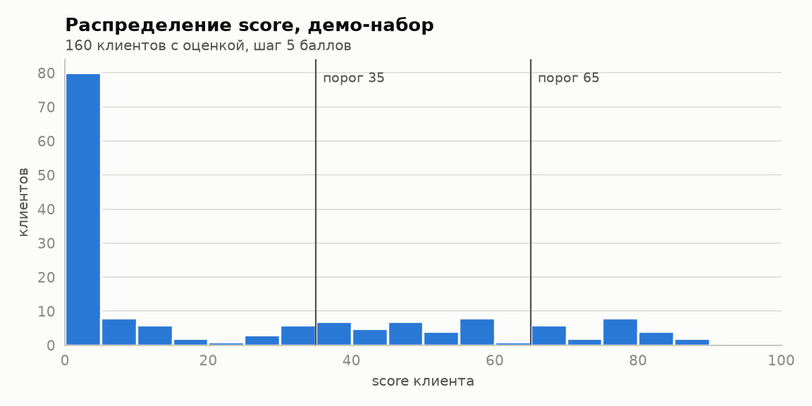
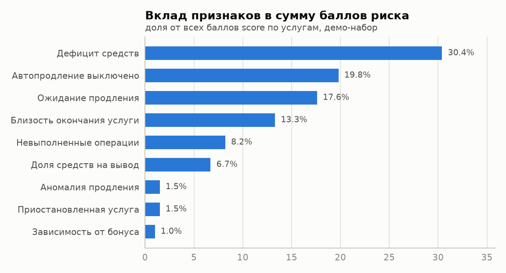
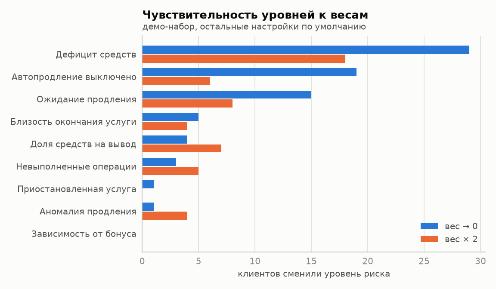
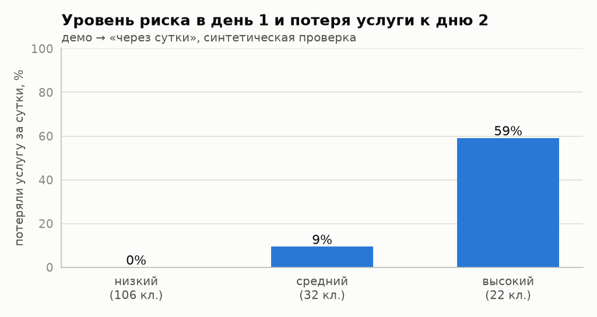
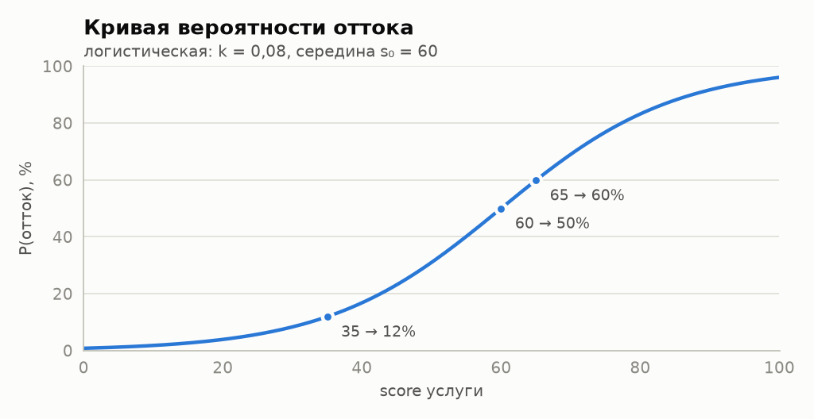
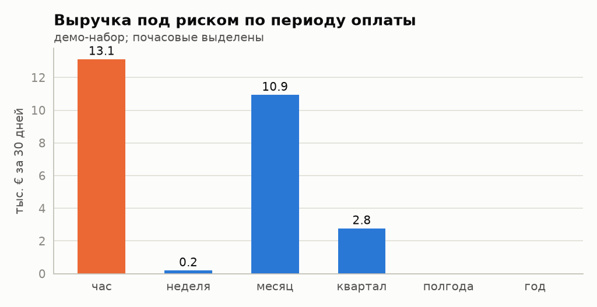

# Анализ модели и метрик

Документ показывает, как модель ведёт себя на данных: какие признаки решают, насколько устойчивы уровни риска к настройкам, совпадают ли оценки с тем, что происходит дальше, и где денежные метрики могут вводить в заблуждение. Все цифры и графики получены из рабочего кода скоринга (`backend/app/scoring`) с настройками по умолчанию.

Воспроизвести:

```bash
pip install -r backend/requirements.txt -r tools/requirements-analysis.txt
python tools/analyze_model.py      # -> docs/img/analysis-*.png, docs/analysis-data.json
```

Каждое число ниже есть в `docs/analysis-data.json`.

## Главное

- Ранжирование клиентов устойчиво. При обнулении или удвоении любого веса ранговая корреляция Спирмена с исходным порядком не ниже **0,94**, ожидаемые потери меняются не больше чем на **±4,5 %**.
- Уровни риска чувствительны к **горизонту оценки**: при 3 или 14 днях вместо 7 уровень меняется у 21–25 из 160 клиентов. Это главный параметр, который нужно согласовать с бизнесом.
- Модель различает будущие потери. На сценарии «через сутки» score первого дня отделяет клиентов, потерявших услугу, с **AUC = 0,97**. Из «высоких» потеряли услугу **59 %**, из «средних» — **9 %**, из «низких» — **0 %**. Проверка синтетическая, оговорки ниже.
- **Почасовые услуги** искажают деньги: 9 таких услуг из 486 дают **49 %** выручки под риском в демо-наборе и **99,8 %** в официальном. Поэтому доля почасовых показывается на дашборде рядом с суммой.
- Найдено ограничение: когда клиент теряет одну рисковую услугу из нескольких, модель опускает его в «низкий» риск, потому что смотрит только на оставшиеся услуги. Рекомендация описана в разделе 5.
- Анализ нашёл и закрыл две проблемы: метрика «Можно предотвратить» не учитывала услуги в `prolong_wait`, а демо-данные состояли из пяти шаблонов (подробно в разделе 8).

## 1. Данные

| Набор | Клиентов | Услуг | Транзакций | Момент оценки | Уровни: низкий / средний / высокий / ушёл / нет оценки |
|---|---|---|---|---|---|
| `official` (из ТЗ) | 10 | 30 | 100 | 19.10.2026 14:35 | 2 / 3 / 1 / 4 / 0 |
| `demo` | 200 | 486 | 1209 | 24.10.2026 00:00 | 106 / 32 / 22 / 24 / 16 |
| `demo-step2` (через сутки) | 200 | 486 | 1221 | 25.10.2026 00:00 | 129 / 25 / 3 / 27 / 16 |

Официальный набор слишком мал для статистики: 10 клиентов, ровно по 6 услуг каждого статуса и по 5 каждого периода оплаты. Он служит эталоном для проверки формул (тесты сверяют score и деньги с ручным расчётом). Распределения и чувствительность изучены на демо-наборе. Его генерирует `tools/generate_demo.py` с фиксированным seed. Набор содержит пять сегментов клиентов (благополучные, под наблюдением, рисковые, ушедшие, без услуг) с разбросом балансов, цен, сроков и истории транзакций. Внутри одного уровня клиенты разные: 103 различных значения score у 160 оценённых клиентов.

## 2. Распределение оценок



- Распределение сильно скошено: пик у нуля и длинный хвост. Половина клиентов (80) получают score ниже 5: у них нет ни одного активного сигнала (услуги далеко от окончания, автопродление включено, денег хватает). Остальные распределены по всей шкале до 90.
- Медиана 5,0, среднее 23,8. Среднее заметно тянут вверх рисковые клиенты, поэтому на дашборде средний риск подписан «по клиентам с оценкой» и не должен читаться как «типичный клиент».
- Около порогов 35 и 65 нет скоплений, то есть пороги не режут плотную группу пополам. Это видно и по таблице порогов в разделе 4.

## 3. Какие признаки решают



| Признак | Вес | Применим к услугам | Среднее значение, когда применим | Доля всех баллов |
|---|---|---|---|---|
| Дефицит средств | 25 | 100 % | 0,14 | 30,4 % |
| Автопродление выключено | 25 | 93 % | 0,11 | 19,8 % |
| Ожидание продления | 25 | 7 % | 0,93 | 17,6 % |
| Близость окончания услуги | 20 | 93 % | 0,09 | 13,3 % |
| Невыполненные операции | 5 | 100 % | 0,19 | 8,2 % |
| Доля средств на вывод | 5 | 100 % | 0,16 | 6,7 % |
| Аномалия продления | 10 | 2 % | 1,00 | 1,5 % |
| Приостановленная услуга | 5 | 10 % | 0,40 | 1,5 % |
| Зависимость от бонуса | 5 | 11 % | 0,24 | 1,0 % |

Выводы:

- Четыре «прямых» признака дают 81 % баллов, и это соответствует замыслу: риск определяется деньгами и сроками.
- «Ожидание продления» срабатывает редко (7 % услуг), но почти всегда в полную силу (0,93). Это самый «острый» сигнал.
- Слабые признаки аккаунта («невыполненные операции», «вывод») применимы ко всем услугам и вместе дают ~15 % баллов при весе 10 из 125. Они поднимают фон у благополучных клиентов на несколько баллов. На уровни это почти не влияет (см. чувствительность), но на реальных данных их стоит проверить первыми: в синтетике связь с оттоком не подтверждена.
- В официальном наборе картина другая: «ожидание продления» даёт 33 % баллов, потому что там треть услуг в `prolong_wait`.

## 4. Устойчивость к настройкам

### Веса



Обнуление или удвоение каждого веса по отдельности (из 160 оценённых клиентов):

| Признак | Сменили уровень (вес → 0 / × 2) | Ранговая корреляция (мин.) | Изменение ожидаемых потерь |
|---|---|---|---|
| Дефицит средств | 29 / 18 | 0,98 | +2,6 % / +2,4 % |
| Автопродление выключено | 19 / 6 | 0,99 | −3,8 % / +3,6 % |
| Ожидание продления | 15 / 8 | 0,99 | −3,7 % / +2,1 % |
| Близость окончания | 5 / 4 | 0,97 | +2,8 % / −1,0 % |
| Доля средств на вывод | 4 / 7 | 0,95 | +4,2 % / −4,5 % |
| Невыполненные операции | 3 / 5 | 0,97 | +2,4 % / −2,4 % |
| Аномалия продления | 1 / 4 | 1,00 | −0,4 % / +0,5 % |
| Приостановленная услуга | 1 / 0 | 0,99 | −0,1 % / +0,1 % |
| Зависимость от бонуса | 0 / 0 | 1,00 | 0 / 0 |

- Порядок клиентов почти не меняется ни при каком весе: корреляция ≥ 0,94. Для работы с клиентами важен именно порядок («кому звонить первым»), и он устойчив.
- Уровни сильнее всего зависят от трёх главных весов. Это ожидаемо и правильно: именно их стоит калибровать.
- «Зависимость от бонуса» на этих данных ни на что не влияет. Это кандидат на удаление или пересмотр формулы.
- Обнуление признаков, которые применимы почти ко всем услугам и обычно близки к нулю (вывод средств, невыполненные операции, близость окончания и даже дефицит средств), *увеличивает* ожидаемые потери. Такой признак добавляет свой вес в знаменатель, почти ничего не добавляя в числитель, и разбавляет сильные сигналы. Это следствие формулы «среднее по применимым признакам», его стоит учитывать при калибровке.

### Пороги уровней

| Пороги (низкий / высокий) | Низкий | Средний | Высокий |
|---|---|---|---|
| 25 / 55 | 97 | 32 | 31 |
| 30 / 60 | 100 | 37 | 23 |
| **35 / 65 (по умолчанию)** | **106** | **32** | **22** |
| 40 / 70 | 113 | 31 | 16 |
| 45 / 75 | 118 | 28 | 14 |

Сдвиг на 5 баллов перемещает 1–9 клиентов между соседними уровнями, резких скачков нет.

### Горизонт оценки и вес максимума α

| Горизонт, дней | 3 | **7** | 14 | 30 |
|---|---|---|---|---|
| Сменили уровень | 25 | — | 21 | 35 |
| Высокий риск | 13 | **22** | 30 | 34 |
| Ранговая корреляция | 0,93 | 1 | 0,91 | 0,85 |
| «Можно предотвратить», € | 15 186 | **15 956** | 17 664 | 20 424 |

Горизонт — самый влиятельный параметр: он одновременно меняет «близость окончания», «автопродление» и «дефицит средств». Его выбор — бизнес-решение («за сколько дней мы успеваем отреагировать»), а не технический. Вес α (максимум против среднего по услугам) влияет слабее: при α = 0,5 или 1,0 уровень меняется у 11 клиентов, корреляция ≥ 0,99.

## 5. Совпадают ли оценки с тем, что происходит дальше

Реальной истории оттока в комплекте нет, поэтому прямую точность (AUC, калибровку) на настоящих данных посчитать нельзя. Вместо этого используется второй снимок демо-набора: те же клиенты через сутки (`data/demo-step2.json`). За сутки часть рисковых клиентов пополнила баланс и включила автопродление, часть потеряла услуги: неоплаченные `prolong_wait` удалены, почасовые без денег заблокированы.



| Уровень в день 1 | Клиентов | Потеряли услугу к дню 2 | Средняя P(отток) модели |
|---|---|---|---|
| Низкий | 106 | 0 (0 %) | 1,8 % |
| Средний | 32 | 3 (9 %) | 29,3 % |
| Высокий | 22 | 13 (59 %) | 76,6 % |

- **AUC = 0,971**: score первого дня почти идеально отделяет 16 клиентов, потерявших услугу, от остальных 144.
- **Монотонность**: доля потерь растёт с уровнем, и в «низком» потерь нет.
- 18 «высоких» клиентов дня 1 к дню 2 опустились до «низкого» или «среднего», но по двум разным причинам:
  - **5 пополнили баланс и включили автопродление.** Например, клиент 24: score 89,8 → 4,2, баланс 2,07 € → 405,11 €. Это шаг 5 сценария демо.
  - **12 потеряли рисковую услугу** и стали «низкими» просто потому, что модель оценивает только оставшиеся живые услуги. Это ограничение модели, разобранное ниже.
- P(отток) выше наблюдаемой доли. Так и должно быть: P относится к горизонту денежной оценки (30 дней), а проверка покрывает одни сутки.

**Ограничение.** Сценарий «через сутки» сгенерирован по правилам, похожим на признаки модели (нет денег и ждёт продления → удаление). Поэтому высокий AUC показывает, что модель и правила платформы согласованы и код работает правильно, но не доказывает точность на реальных клиентах. Как получить честную оценку, описано в разделе 9.

**Ограничение: после частичного ухода риск падает.** Если у клиента удалили одну услугу из нескольких, модель смотрит на оставшиеся и видит благополучного клиента. Потерянная выручка тоже этого не учитывает: по ТЗ она считается только по клиентам в состоянии «ушёл». На практике клиент, который только что потерял услугу, скорее всего входит в группу риска. Рекомендация: добавить признак «недавняя потеря услуги» по истории `app.service_status_events` (например, переход в `deleted`/`blocked` за последние 30 дней), а частичные потери учитывать в отдельной денежной метрике.

## 6. Денежные метрики



Логистическая кривая переводит score в вероятность: 35 → 12 %, 60 → 50 %, 65 → 60 %, 85 → 88 %. Она монотонна и ограничена, поэтому ожидаемые потери не уходят в ноль или бесконечность на краях шкалы.

| Метрика, € | official | demo | demo через сутки |
|---|---|---|---|
| Выручка под риском | 11 556 | 27 005 | 10 339 |
| Ожидаемые потери | 5 106 | 15 096 | 2 500 |
| Можно предотвратить | 0 | 15 956 | 1 985 |
| Потерянная выручка / мес. | 7 354 | 7 754 | 9 734 |
| Доля почасовых в выручке под риском | 99,8 % | 48,6 % | 5,9 % |

Между двумя снимками ожидаемые потери упали в 6 раз, а потерянная выручка выросла на 1 980 €. Это и есть две стороны суток: часть клиентов спасена, часть ушла.



**Почасовые услуги.** Стоимость услуги за 30 дней равна `цена × 30 / длина периода`, и у почасовой услуги это 720 цен. В демо-наборе 9 почасовых услуг (2 % всех) дают 13,1 тыс. € из 27 тыс. € выручки под риском. В официальном наборе их доля 99,8 %, так что сумма там почти целиком состоит из пяти почасовых услуг. Это не ошибка формулы, но цифру легко неверно прочитать, поэтому на дашборде рядом выводится «доля почасовых». Если бизнес не считает, что почасовая услуга проработает весь месяц, для неё стоит ограничить горизонт (например, сутками).

**«Можно предотвратить»** считает нехватку денег по стоимости за 30 дней, а не по сумме следующего платежа. Для годовой услуги это меньше реального платежа, для почасовой — больше. Формула взята из ТЗ без изменений, а смысл цифры объяснён в подсказке «Формула».

## 7. Официальный набор: что видно по клиентам

| Клиент | Уровень | Score | Главная причина |
|---|---|---|---|
| 1 | средний | 47,9 | Автопродление выключено, почасовая услуга истекает в момент оценки |
| 2, 3, 7, 8 | ушёл | — | все услуги удалены или заблокированы |
| 4 | низкий | 19,4 | Услуга истекает через 1 сутки |
| 5 | высокий | 80,1 | Услуга ждёт продления 370 суток при достаточном балансе |
| 6 | низкий | 34,0 | Автопродление выключено, истекает через 7 суток; баланс 34,78 € |
| 9 | средний | 63,7 | Автопродление выключено, услуга истекла 40 суток назад |
| 10 | средний | 50,9 | Услуга ждёт продления 309 суток |

**Качество данных.** В официальном наборе все 6 услуг в `prolong_wait` ждут продления от 35 до 400 суток, хотя по правилам платформы через 5 суток их удаляют. Две «активные» услуги уже истекли. Скорее всего, данные синтетические и статусы не согласованы с датами. Модель не исправляет данные молча: такие случаи получают предупреждение в карточке клиента (11 предупреждений по 3 правилам), а score считается по тем статусам, что пришли.

Клиент 6 — пограничный случай: баланс 34,78 € и истекающая услуга без автопродления дают score 34,0, на 1 балл ниже порога «среднего». Он хорошо показывает, зачем на вкладке «Модель» нужны настраиваемые пороги.

## 8. Что анализ нашёл и что исправлено

| Находка | Что сделано |
|---|---|
| «Можно предотвратить» не учитывала услуги в `prolong_wait`: они уже истекли, хотя их ещё можно оплатить до удаления. Самые «спасаемые» деньги не попадали в метрику | `prolong_wait`, истёкшие не больше 5 суток назад, теперь входят в расчёт (`money.py`, тест `test_recoverable_includes_prolong_wait_in_grace_period`) |
| Демо-набор состоял из 5 шаблонов: все «высокие» клиенты с балансом 8 € и score ровно 79,9. Распределения и чувствительность на таком наборе бессмысленны | Генератор переписан: сегменты с разбросом, даты удалений распределены по 4 месяцам, добавлены случаи для предупреждений качества |
| Для шага 5 сценария демо не было второго снимка, линия «Факт» на графике оставалась пустой | `data/demo-step2.json` и кнопка «Демо: через сутки» на вкладке «Данные» |
| Метрики на дашборде, в `/metrics` и в таблице клиентов могли расходиться (пересчитывались в разные моменты) | Единый источник правды: всё читается из результата последнего пересчёта (см. `docs/architecture.md`), согласованность покрыта тестами |

## 9. Ограничения и как калибровать на реальных данных

1. **Нет меток оттока.** Нужна история снимков минимум за 2–3 месяца. Факт ухода — переход всех услуг клиента в `deleted`/`blocked` (его уже собирает `app.service_status_events`).
2. **Калибровка вероятности.** На этой истории нужно подобрать `k` и `s₀` логистической регрессией «score → ушёл в течение 30 дней» и проверить калибровку по Брайеру и по графику надёжности (децили score против доли ушедших).
3. **Качество ранжирования**: ROC AUC и PR AUC на отложенном по времени периоде (обучение на ранних месяцах, проверка на поздних), а также lift в «высоком» уровне.
4. **Веса.** Их можно подобрать той же логистической регрессией по значениям признаков, сохранив прозрачность: веса останутся числами на вкладке «Модель». Начать стоит с признаков, которые сейчас дают много баллов при неясной связи с оттоком (вывод средств, невыполненные операции, бонус).
5. **Горизонт** согласовать с операционным циклом удержания: сколько дней нужно, чтобы связаться с клиентом и он успел оплатить.
6. **Почасовые услуги.** Решить, считать ли их стоимость за полный месяц или за ограниченный срок.
7. **Частичный отток.** Добавить признак «недавняя потеря услуги» и метрику потерянной выручки по удалённым услугам у ещё активных клиентов (см. раздел 5).
