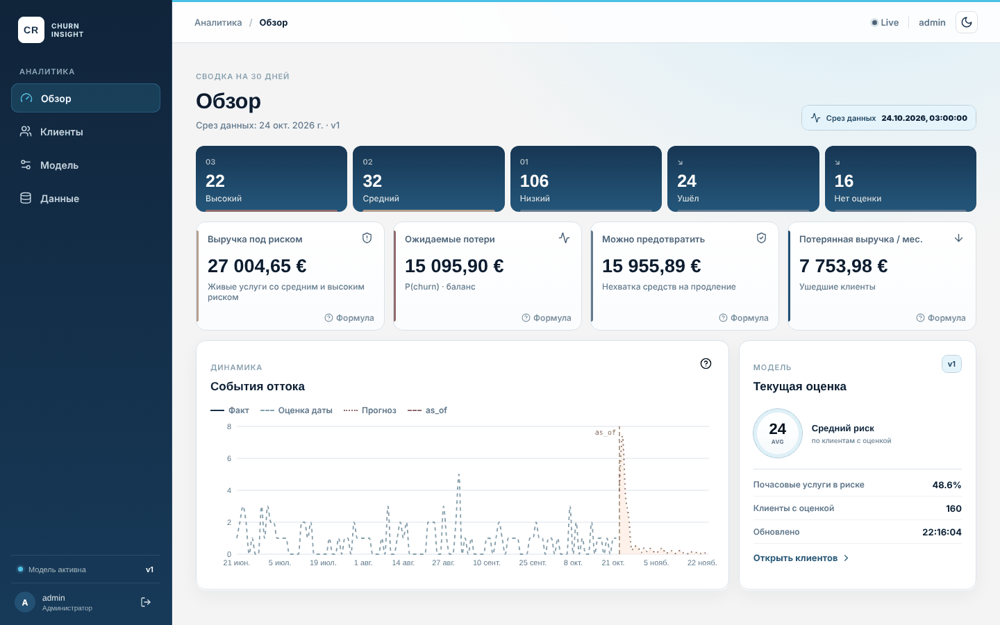
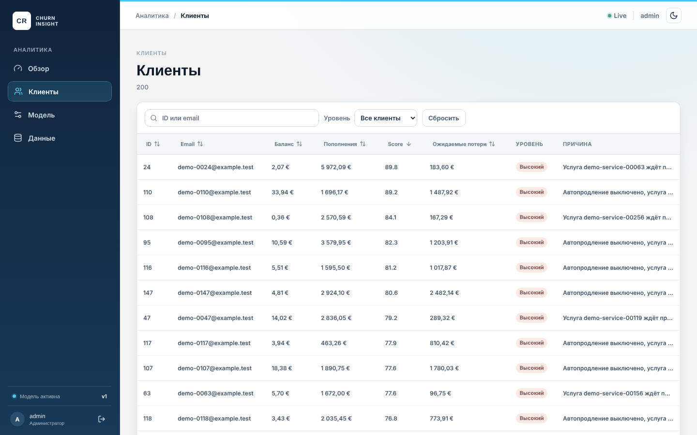
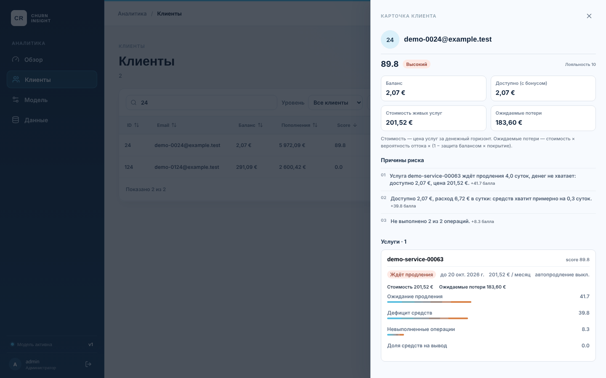
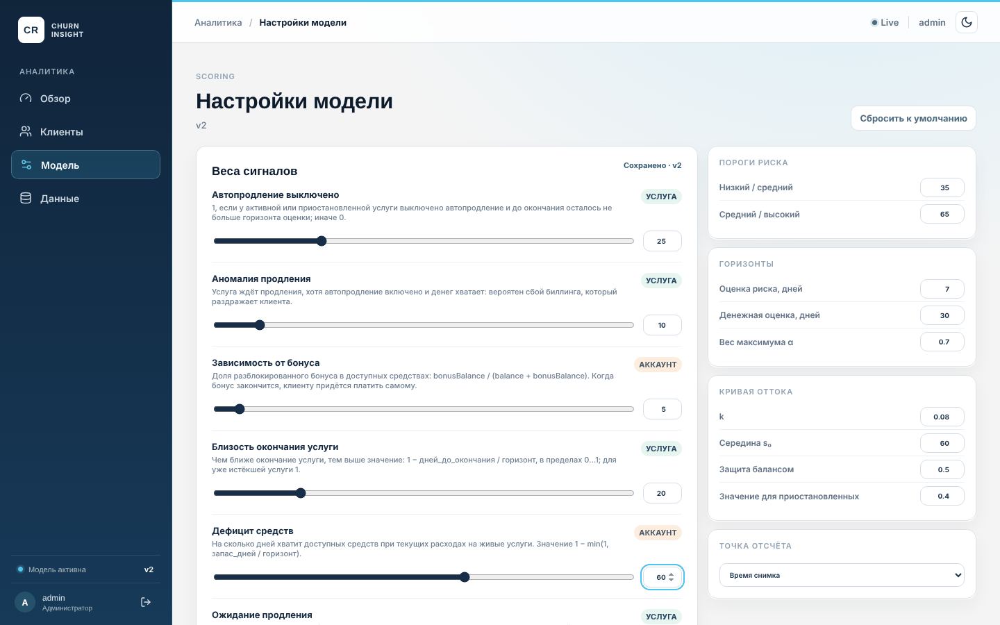
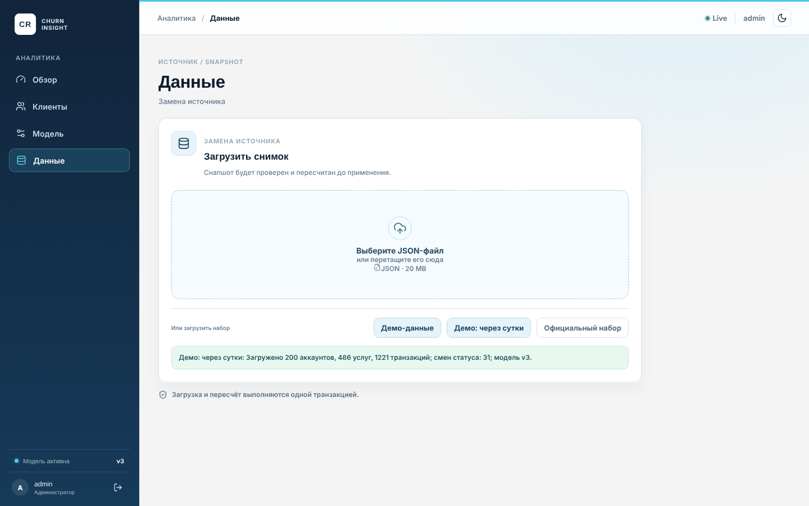
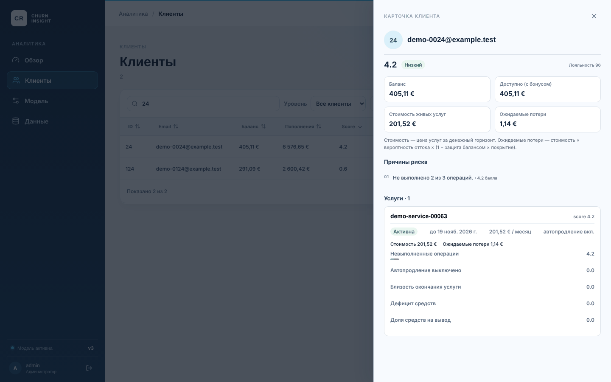
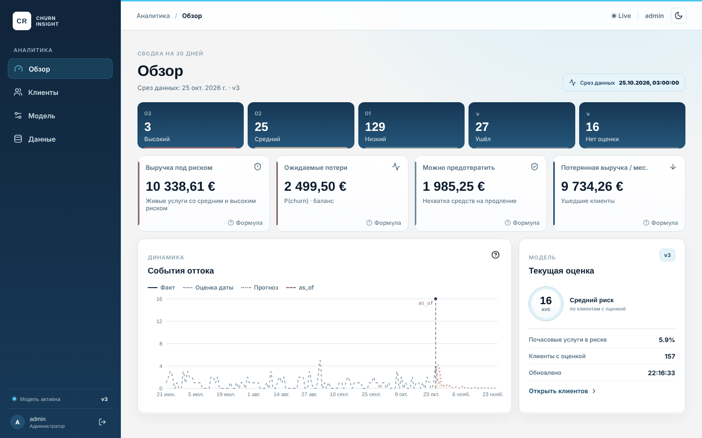

# Сценарий демо (5 минут)

Сценарий из раздела 8 `PLAN.md` на встроенном демо-наборе: что нажимать и что должно получиться. Все цифры ниже — для демо-набора с настройками модели по умолчанию.

## Подготовка

```bash
docker compose up -d --build
```

Откройте <http://localhost:8081> и войдите (логин и пароль из `.env`). На вкладке «Данные» нажмите **«Демо-данные»**. Если настройки модели меняли, на вкладке «Модель» нажмите **«Сбросить к умолчанию»**.

## 1. Дашборд: кто под риском и сколько это стоит



- **Уровни риска:** 22 высоких, 32 средних, 106 низких; 24 клиента ушли, у 16 нет услуг.
- **Деньги:** выручка под риском 27 004,65 €, ожидаемые потери 15 095,90 €, можно предотвратить 15 955,89 €. У каждой цифры есть подсказка «Формула».
- **Сводка справа:** почасовые услуги дают 48,6 % выручки под риском. Это стоит проговорить вслух: в разделе 6 [анализа](analysis.md) объяснено, почему такая услуга «весит» за 30 дней в 720 раз больше своей цены.
- **Индикатор Live** в шапке: панель подписана на обновления и сама перерисуется после следующих шагов.

## 2. Клиенты: самые рисковые сверху



Таблица по умолчанию отсортирована по score по убыванию. Первым идёт **клиент 24**: score 89,8, баланс 2,07 €, причина «услуга ждёт продления 4 суток, денег не хватает». Клик по заголовку столбца меняет сортировку, стрелка показывает направление. Фильтр «Уровень» и поиск по ID или email работают вместе.

## 3. Карточка клиента: почему риск высокий



Откройте клиента 24. В карточке видно:

- **Три причины** с вкладом в баллах: ожидание продления (+41,7), дефицит средств (+39,8), невыполненные операции (+8,3).
- **Деньги:** стоимость живых услуг 201,52 €, ожидаемые потери 183,60 €.
- **Услуга `demo-service-00063`:** статус «Ждёт продления», автопродление выключено, полосы вклада признаков.

## 4. Модель: изменение веса пересчитывает всё сразу



На вкладке «Модель» поднимите вес **«Дефицит средств»** с 25 до 60. Через полсекунды появится «Сохранено · v2». Score, уровни, деньги и `/metrics` уже пересчитаны, перезагружать страницу не нужно. Если ввести недопустимое значение (например, нижний порог выше верхнего), форма покажет ошибку и ничего не отправит. Верните настройки кнопкой **«Сбросить к умолчанию»**.

## 5. Новые данные: клиент пополнил баланс



На вкладке «Данные» нажмите **«Демо: через сутки»**. Это те же 200 клиентов на следующий день: часть рисковых клиентов пополнила баланс и включила автопродление, часть потеряла услуги. Сообщение покажет 31 смену статуса.



У клиента 24 баланс вырос до 405,11 €, услуга продлена с автопродлением. Score упал с **89,8 до 4,2**, уровень «Низкий».

## 6. Дашборд и график после обновления



- **Уровни:** высоких стало 3 вместо 22, ожидаемые потери упали с 15 096 € до 2 500 €, потерянная выручка выросла до 9 734 € — те, кто не заплатил, ушли.
- **График (все линии в услугах):** сплошная линия «Факт» — точка в день второго снимка, 16 услуг, перешедших в `deleted`/`blocked`. Серая штриховая «Оценка даты» — удалённые раньше услуги, датированные окончанием + 5 суток. Оранжевый пунктир «Прогноз» — ожидаемое число потерь по дням в ближайшие 30 дней. Вертикальная линия — момент оценки `as_of`.

Чтобы повторить сценарий, снова нажмите «Демо-данные».

## Проверка метрик

После любого шага `/metrics` отдаёт те же числа, что и дашборд:

```bash
curl -H "Authorization: Bearer $METRICS_TOKEN" http://localhost:8081/metrics | grep churn_
```
